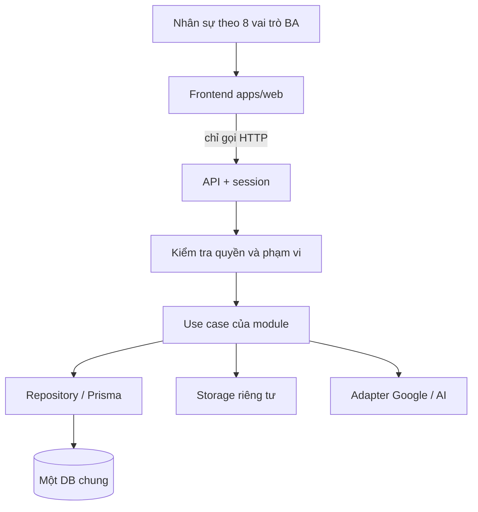
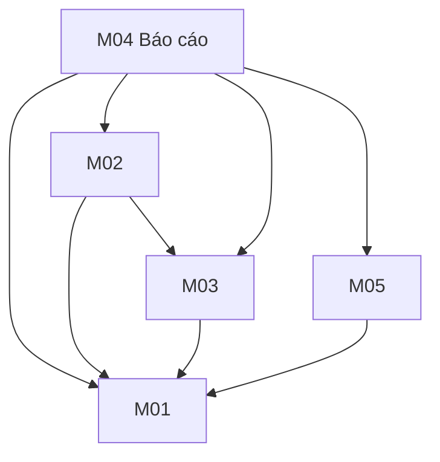

# Dự án Toàn Trung V2 — Phạm vi, nguồn BA và kiến trúc

Gộp từ PROJECT, BA_HANDOVER và ARCHITECTURE cũ. Nguồn nghiệp vụ gốc: [sources](sources/README.md) và [ERD PDF](sources/assets/ba-erd.pdf).

## 1. Mục tiêu

Hệ thống nội bộ quản lý Lead, tiến độ Sales, tracking và báo cáo; giảm nhập lặp, cảnh báo trùng, lưu lịch sử bàn giao/thất bại; hỗ trợ Marketing/Ads đối chiếu dữ liệu thật và Designer tạo bản nháp. Khách hàng là **dữ liệu**, không có tài khoản đăng nhập.

## 2. Năm module và Core

| Module | Phạm vi | Nguồn BA |
| --- | --- | --- |
| M01 `01-leads` | Lead + Pipeline: tiếp nhận/phân công, chuẩn hóa, trùng, Spam, lịch sử, tệp, chuyển Sales, theo dõi báo giá | UC01, UC02; DFD 1.0/2.0 |
| M02 `02-tracking-sync` | Nguồn Lead, tracking, webhook, đồng bộ Google Ads/GA4/Search Console | DFD 3.0; UC03 chưa có mô tả riêng |
| M03 `03-keywords-ads` | Từ khóa/Ads/CPC/ngân sách; SEO tích hợp AI | BFD, DFD 5.0 |
| M04 `04-reports` | Dashboard theo vai trò, 1 tuần/30 ngày/tùy chọn, xuất Excel/Sheets | UC04, DFD 4.0 |
| M05 `05-ai-design` | Nháp phối cảnh 3D, banner, thư viện ấn phẩm, thời gian/token | UC06, DFD 6.0 — giai đoạn 2 |
| Core | Đăng nhập, người dùng, phân quyền, thông báo, hồ sơ, thương hiệu, storage, audit | DFD 7.0 |

Số DFD không phải số nhóm: SEO (DFD 5.0) thuộc M03, không phải M05.

| DFD | Ý nghĩa | Module | Kho dữ liệu |
| --- | --- | --- | --- |
| 1.0 | Tiếp nhận và phân Lead | M01 | D1 |
| 2.0 | Theo dõi Pipeline/báo giá | M01 | D1 |
| 3.0 | Tracking nguồn và đồng bộ | M02 | D3 |
| 4.0 | Báo cáo/Dashboard | M04 | Đọc D1, D3, D5 |
| 5.0 | Nội dung SEO tích hợp AI | M03 | D3, D4, D5 |
| 6.0 | Thiết kế/phối cảnh | M05 | D6 |
| 7.0 | Người dùng/phân quyền | Core | D2 |

Roadmap BA ~10 tuần: GĐ0 (tuần 1–2) khảo sát; GĐ1 (tuần 3–8) Lead–Tracking–Dashboard; GĐ2 (tuần 7–10) từ khóa/Ads và AI thiết kế.

## 3. Truy vết yêu cầu quan trọng

| ID | Nguồn | Yêu cầu | Module |
| --- | --- | --- | --- |
| BA-01 | UC01 | Webhook/nhập tay, chuẩn hóa SĐT, kiểm tra trùng khi tạo/sửa, không tự gộp | M01 |
| BA-02 | UC01 | Tự phân hoặc "Chưa giao"; Sales online/đủ tải; tiếp nhận có thời điểm; Spam giữ Pipeline | M01 + Core |
| BA-03 | UC01/UC03-4 | Marketing xem ẩn danh; Ads xem ẩn danh, chỉ sửa Nguồn/Chiến dịch | M01/M02 |
| BA-04 | UC02 | Thất bại có lý do; chuyển Lead có kiểm tra người nhận, giữ trạng thái | M01 |
| BA-05 | DFD 2.0 | Cảnh báo báo giá quá 7 ngày | M01 |
| BA-06 | DFD 3.0 | Dữ liệu nguồn Google/website thật, lịch đồng bộ | M02 |
| BA-07 | DFD 5.0 | SEO: đề tài/outline/nháp, từ khóa/traffic, duyệt bài, nhật ký AI | M03 |
| BA-08 | UC04 | Dashboard theo vai trò, export đúng dữ liệu được xem | M04 |
| BA-09 | UC06 | Nháp 3D/banner, thư viện/phiên bản, thời gian/token | M05 |
| BA-10 | DFD | Không gửi SĐT/email/thông tin khách cho AI | Core + M03/M05 |

Giới hạn phải giữ: giữ 3 nhóm sản phẩm BA; không portal khách hàng/đăng ký công khai; chưa đưa giá bán/doanh số lên app (chi phí Ads/AI vẫn theo BA); video ngắn chưa phải tính năng cam kết. Điểm chưa chốt ghi tại [OPEN_QUESTIONS](decisions/OPEN_QUESTIONS.md).

## 4. Kiến trúc

Một npm monorepo, 4 workspace:

| Workspace | Vai trò |
| --- | --- |
| `apps/web` | Next.js 14 + React + Tailwind. `src/app` là route; giao diện module ở `src/modules/<module>` |
| `apps/api` | Route Handlers + logic backend. `src/app/api/v1` là HTTP; logic ở `src/core` và `src/modules/<module>` |
| `packages/database` | Prisma. `prisma/schema.prisma` + `prisma/models/*.prisma` gộp thành **một DB chung** |
| `packages/contracts` | DTO/Zod schema thuần, dùng chung FE–BE |

Hiện trạng: Core đã chạy (đăng nhập scrypt + session HttpOnly + CSRF, 8 vai trò/12 quyền, quản lý tài khoản, hồ sơ/avatar, thông báo, cài đặt thương hiệu). DB local là SQLite; production dự kiến PostgreSQL. 5 module đang ở trạng thái trống chờ các nhóm.

Cấu trúc gợi ý bên trong một module (chỉ tách khi cần):

| File | Trách nhiệm |
| --- | --- |
| FE `index.ts`, `api.ts`, `components/` | Giao diện, gọi HTTP qua contracts, trạng thái loading/empty/error |
| BE `public.ts` | Hàm public cho module khác dùng |
| BE `policy.ts` | Quyền BA và phạm vi dữ liệu |
| BE `service.ts` | Nghiệp vụ và transaction |
| BE `repository.ts` | Truy vấn DB của module |
| `__tests__/` | Test hành vi |

Hướng phụ thuộc giữa module (chỉ qua public contract, không import vòng):

- FE không import Prisma/DB/secret. Core không import module. Contracts không import server/DB.
- M04 không tự query bảng nguồn; dùng read contract do owner cung cấp.
- Transaction ngắn, không gọi provider/upload bên trong transaction.
- File thương hiệu công khai ở `apps/web/public/brand`; file khách/thiết kế dùng storage riêng có kiểm tra quyền.

Chi tiết DB: [database](database/README.md). Phân công thư mục: [MODULE_MAP](MODULE_MAP.md).
